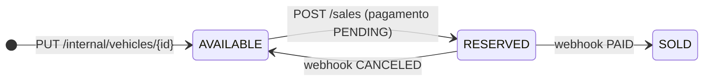

# vehicle-sales-service

Serviço de venda da plataforma de revenda de veículos (Tech Challenge SOAT, Fase 4, trabalho substitutivo).
Atende os endpoints que recebem mais tráfego (**listagens e compras**) e o **webhook do processador de
pagamento**, isolado em um serviço próprio, com **banco de dados exclusivo** e **autoescalonamento (HPA)**.

O cadastro e a edição de veículos ficam no [serviço principal](https://github.com/DanielSteil/vehicle-core-service),
que envia cada alteração para cá por HTTP. A arquitetura completa (diagramas, decisões, modelo de dados e fluxos)
está em [vehicle-core-service/docs/arquitetura.md](https://github.com/DanielSteil/vehicle-core-service/blob/main/docs/arquitetura.md).

## O que este serviço faz

| Requisito do enunciado | Endpoint |
|---|---|
| Listagem de veículos à venda, do mais barato para o mais caro | `GET /vehicles/available` |
| Listagem de veículos vendidos, do mais barato para o mais caro | `GET /vehicles/sold` |
| Efetuar a venda (CPF de quem comprou e data da venda) | `POST /sales` |
| Webhook para o processador de pagamento informar se o pagamento foi efetuado ou cancelado | `POST /webhooks/payments` |
| Receber do serviço principal os veículos cadastrados e editados | `PUT /internal/vehicles/{id}` |

### Ciclo de vida



- **À venda** = `AVAILABLE`. **Vendido** = venda com pagamento `PAID`. Um veículo `RESERVED` (pagamento pendente) não aparece em nenhuma das duas listas e não aceita outra compra.
- O serviço principal só consegue editar um veículo `AVAILABLE`. Nos outros casos este serviço responde `409`, e o principal desfaz a edição.

## Como foi implementado

- **Java 25 + Spring Boot 4.1**, Spring Web MVC, Spring Data JPA, Flyway, Bean Validation, Actuator e springdoc (Swagger).
- **Clean Architecture:** `domain` (Vehicle, Sale, Cpf: regras sem framework) → `application` (casos de uso e portas) → `infrastructure` (REST, JPA, filtros de segurança, configuração).
- **Banco segregado:** PostgreSQL `sales_db`, exclusivo deste serviço. Guarda uma cópia local dos dados do veículo, para que as listagens e compras não dependam do serviço principal.
- **Listagens rápidas:** índices `(status, price, id)` e `(payment_status, price, id)`, com paginação (`?page=0&size=20`, máximo 100).
- **Compra:**
  - O CPF é validado pelos dígitos verificadores, com ou sem máscara.
  - A data da venda é opcional (padrão: hoje) e não pode estar no futuro.
  - O preço é copiado no momento da compra.
  - É gerado um `paymentCode`, o código que o processador de pagamento usa no webhook.
- **Concorrência:** lock otimista (`version`) e um índice único parcial (uma venda ativa por veículo). Com dois compradores simultâneos, um recebe `201` e o outro `409`. Isso é coberto por teste.
- **Webhook idempotente:** a mesma notificação repetida devolve `200` sem efeito. Uma notificação contraditória (cancelar o que já foi pago) devolve `409`.
- **Segurança:**
  - `/internal/**` exige `X-Internal-Token` e `/webhooks/**` exige `X-Webhook-Secret`, comparados em tempo constante.
  - A aplicação não sobe sem os segredos.
  - O CPF sai mascarado nas respostas (`***.982.247-**`), por causa da LGPD.
- **Erros** no padrão RFC 9457 (`application/problem+json`): `400` validação, `401` segredo, `404`, `409` estado, `422` regra de negócio.

## Como usar localmente

Sozinho (serviço + banco):

```bash
docker compose up -d --build
```

Para subir a plataforma completa (com o serviço principal), use o `docker-compose.yml` do
[vehicle-core-service](https://github.com/DanielSteil/vehicle-core-service), com os dois repositórios clonados lado a lado.

| Componente | Endereço |
|---|---|
| API | http://localhost:8082 |
| Swagger | http://localhost:8082/swagger-ui.html |
| Banco `sales_db` | `localhost:15433` (usuário e senha `sales`) |

Segredos do ambiente local: `X-Internal-Token: local-internal-token` e `X-Webhook-Secret: local-webhook-secret`.

```bash
# veículo chegando do serviço principal
curl -s -X PUT localhost:8082/internal/vehicles/3f1c2a9e-1111-4c1d-9a1b-2a3b4c5d6e7f \
  -H 'Content-Type: application/json' -H 'X-Internal-Token: local-internal-token' \
  -d '{"brand":"Toyota","model":"Corolla","year":2022,"color":"Prata","price":120000.00}'

curl -s localhost:8082/vehicles/available

curl -s -X POST localhost:8082/sales -H 'Content-Type: application/json' \
  -d '{"vehicleId":"3f1c2a9e-1111-4c1d-9a1b-2a3b4c5d6e7f","buyerCpf":"529.982.247-25"}'

curl -s -X POST localhost:8082/webhooks/payments -H 'Content-Type: application/json' \
  -H 'X-Webhook-Secret: local-webhook-secret' -d '{"paymentCode":"<paymentCode>","status":"PAID"}'

curl -s localhost:8082/vehicles/sold
```

## Como testar

```bash
mvn verify
```

- **Testes unitários:** CPF, máquina de estados do veículo e da venda, e casos de uso com repositórios em memória.
- **Testes de integração:** a aplicação inteira contra um **PostgreSQL real (Testcontainers)**. Cobrem:
  - todos os endpoints, nos caminhos de sucesso e de erro;
  - ordenação e paginação das listagens;
  - autenticação do webhook e do endpoint interno;
  - webhook repetido e contraditório;
  - compra simultânea;
  - lock otimista.
- **Cobertura:** o JaCoCo faz o build falhar abaixo de **80% das linhas**. Hoje está em **99,4% de linhas e 95% de branches** (77 testes). O relatório fica em `target/site/jacoco/index.html` e também é publicado como artefato em cada execução do CI.

> O Docker precisa estar rodando, porque os testes de integração sobem um contêiner PostgreSQL.

## Deploy (Kubernetes)

Manifests em [`k8s/`](k8s), organizados pelo Kustomize:

| Arquivo | Recurso |
|---|---|
| `namespace.yaml` | Namespace `vehicle-platform` |
| `sales-db.yaml` | `StatefulSet` + `Service` do PostgreSQL exclusivo, com `PersistentVolumeClaim` |
| `configmap.yaml` | URL do banco |
| `deployment.yaml` | `Deployment` com 2 réplicas, startup, liveness e readiness probes, requests e limits |
| `service.yaml` | `Service` NodePort 30082 (dentro do cluster: `http://vehicle-sales-service`) |
| `hpa.yaml` | `HorizontalPodAutoscaler`: 2 a 6 réplicas, alvo de 70% de CPU |

Deploy manual (o mesmo script que o pipeline usa):

```bash
IMAGE=ghcr.io/danielsteil/vehicle-sales-service:latest \
SALES_DB_PASSWORD=<senha> INTERNAL_API_TOKEN=<token> WEBHOOK_SECRET=<segredo> \
KUBE_CONTEXT=minikube ./scripts/deploy.sh
```

**Demonstração do autoescalonamento:** `KUBE_CONTEXT=minikube ./scripts/load-test.sh 6 120` sobe 6 pods que
consultam a vitrine sem parar e mostra o HPA reagindo. No teste local, as réplicas foram de 2 para 4 quando a CPU
chegou a 121%.

## CI/CD

| Workflow | Gatilho | O que faz |
|---|---|---|
| [`ci.yml`](.github/workflows/ci.yml) | Pull Request para a `main` | `mvn verify` (testes, Testcontainers, trava de 80%), resumo da cobertura no PR, relatórios como artefato e build da imagem |
| [`cd.yml`](.github/workflows/cd.yml) | Merge na `main` | Roda o CI de novo → publica a imagem no GHCR (`:<sha>` e `:latest`) → deploy no Kubernetes → smoke test |

**Configuração do repositório:**

1. **Proteção da `main`:** exigir Pull Request e o check *Build, testes e cobertura* passando.
2. **Secrets:**
   - `SALES_DB_PASSWORD`;
   - `INTERNAL_API_TOKEN` (o mesmo valor do serviço principal);
   - `WEBHOOK_SECRET` (entregue ao processador de pagamento).
3. **Runner auto-hospedado** com o label `minikube`, na máquina do cluster (`minikube start` e `minikube addons enable metrics-server`).
4. **Pacote `vehicle-sales-service` público no GHCR** depois do primeiro deploy.

## Variáveis de ambiente

| Variável | Padrão local | Descrição |
|---|---|---|
| `DB_URL` | `jdbc:postgresql://localhost:15433/sales_db` | URL JDBC do banco exclusivo |
| `DB_USERNAME` / `DB_PASSWORD` | `sales` / `sales` | Credenciais do banco |
| `INTERNAL_API_TOKEN` | (obrigatória) | Segredo do header `X-Internal-Token` |
| `WEBHOOK_SECRET` | (obrigatória) | Segredo do header `X-Webhook-Secret` |
| `PORT` | `8080` | Porta HTTP |
